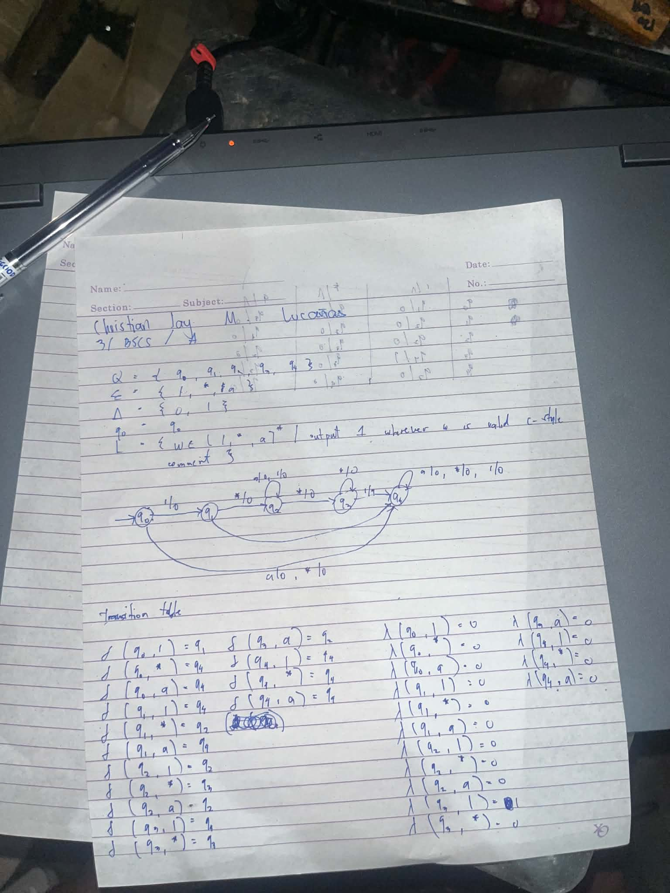
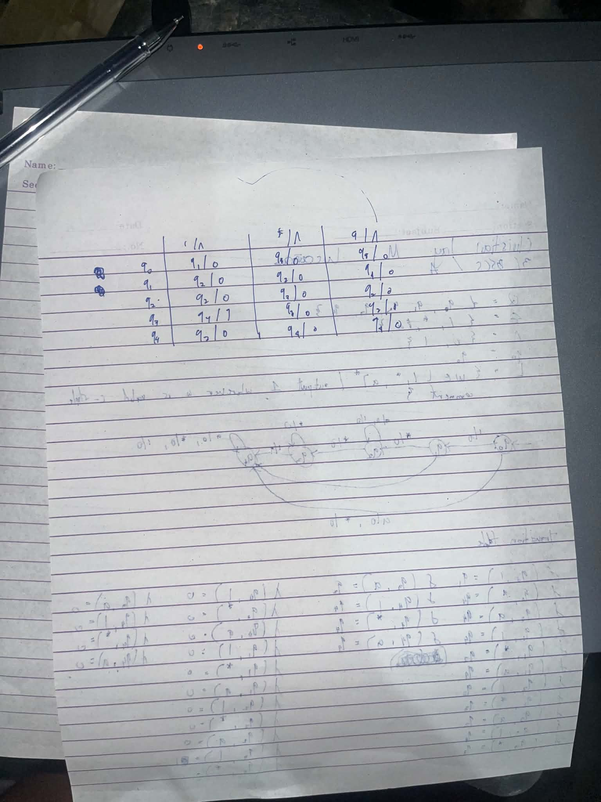

# Mealy Machine for C-Style Comments

This repository contains a C++ implementation and the theoretical design for a **5-state Mealy Machine** that recognizes valid C-style block comments.

## Assignment Overview

The objective of this assignment is to design an automaton that accepts correct comment syntax (starting with `/*` and ending with `*/`) and rejects comments with incorrect syntax.

The alphabet $\Sigma$ consists of `/`, `*`, and `a` (where `a` represents any character that is not a star or a slash).

Unlike a standard DFA or NFA which uses final/accepting states, this Mealy Machine uses a **transition-based output function** ($\Delta = \{0, 1\}$) to output `1` upon completing a valid comment and `0` for any unclosed, invalid, or trailing sequence:
- It must output `1` and close on the first `*/` it encounters.
- It must reject strings that have trailing characters after the comment is closed.
- It must reject unclosed comments or comments with invalid starting sequences.

---

## Written Activity / State Machine Design

Below is the theoretical design, mathematical definition, and transition table for the 5-state minimized Mealy Machine.

### Formal 6-Tuple Definition $M = (Q, \Sigma, \Delta, \delta, \lambda, q_0)$

- **$Q$ (States):** $\{q_0, q_1, q_2, q_3, q_4\}$
- **$\Sigma$ (Inputs):** $\{/, *, a\}$
- **$\Delta$ (Outputs):** $\{0, 1\}$ *(where 0 = Reject/Ongoing, 1 = Valid Comment Completed)*
- **$q_0$ (Start State):** $q_0$

### Mealy Transition & Output Table ($\delta \text{ / } \lambda$)

| Current State ($Q$) | Input `/` | Input `*` | Input `a` |
| :--- | :--- | :--- | :--- |
| **$\to q_0$** | $q_1 \text{ / } 0$ | $q_4 \text{ / } 0$ | $q_4 \text{ / } 0$ |
| **$q_1$** | $q_4 \text{ / } 0$ | $q_2 \text{ / } 0$ | $q_4 \text{ / } 0$ |
| **$q_2$** | $q_2 \text{ / } 0$ | $q_3 \text{ / } 0$ | $q_2 \text{ / } 0$ |
| **$q_3$** | **$q_4 \text{ / } 1$** | $q_3 \text{ / } 0$ | $q_2 \text{ / } 0$ |
| **$q_4$** | $q_4 \text{ / } 0$ | $q_4 \text{ / } 0$ | $q_4 \text{ / } 0$ |

### State Diagram

*Below is the handwritten diagram of the 5-state Mealy Machine showing input symbols and their respective outputs:*




---

## C++ Implementation

The logic is implemented in C++ as a deterministic finite-state transducer. It evaluates input strings character by character, printing the output symbol (`0` or `1`) dynamically. An input string is formally **Accepted** if and only if the final transition emits a `1`.


### Code Output

Below is the expected console output of the test cases running through the Mealy machine compilation:

```text
=== MEALY MACHINE STRING EVALUATION ===
Input: /*a*/           | Output: 00001 | Result: ACCEPTED
Input: /**/            | Output: 0001 | Result: ACCEPTED
Input: /***/           | Output: 00001 | Result: ACCEPTED
Input: /*aaa*aaa*/     | Output: 00000000001 | Result: ACCEPTED
Input: /**             | Output: 000 | Result: REJECTED
Input: /*/             | Output: 000 | Result: REJECTED
Input: /**a/           | Output: 00000 | Result: REJECTED
Input: //aaaa          | Output: 000000 | Result: REJECTED
Input: /*a*/a          | Output: 000010 | Result: REJECTED